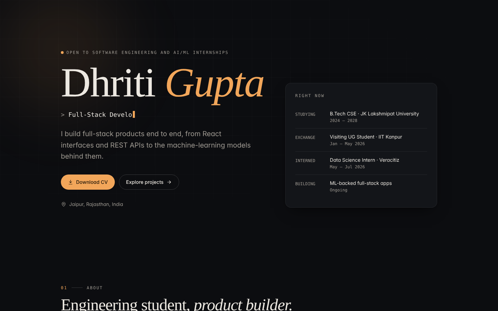
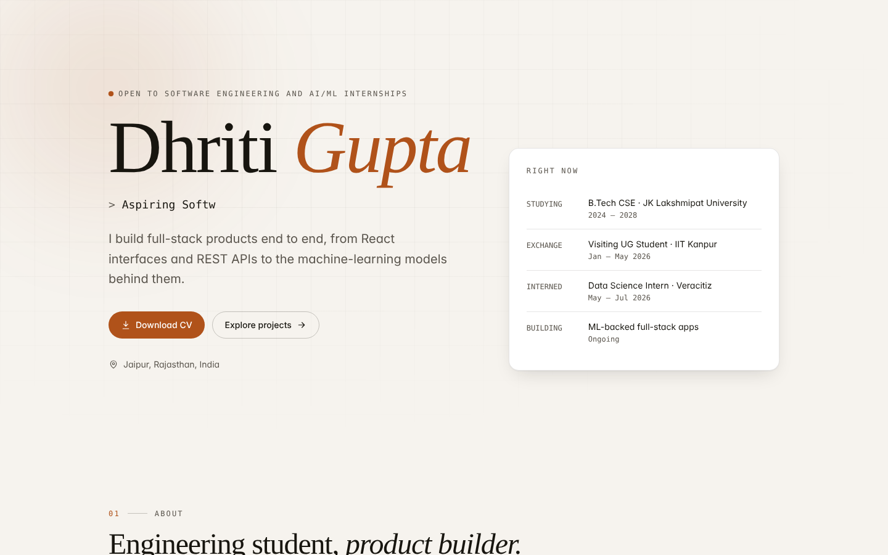
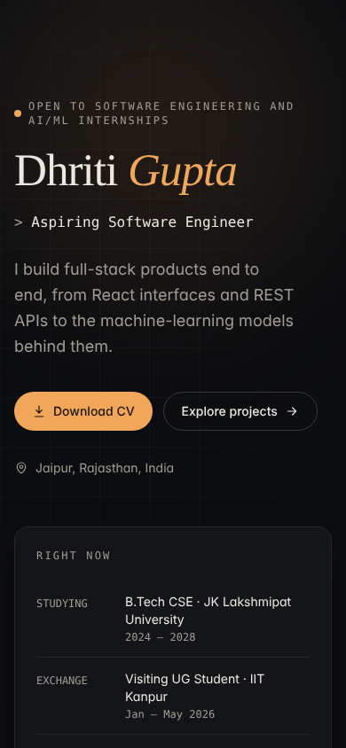
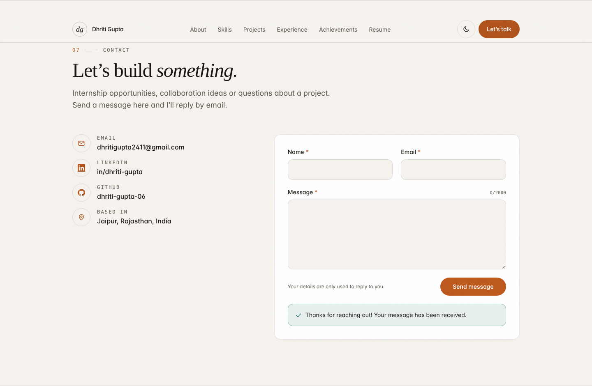
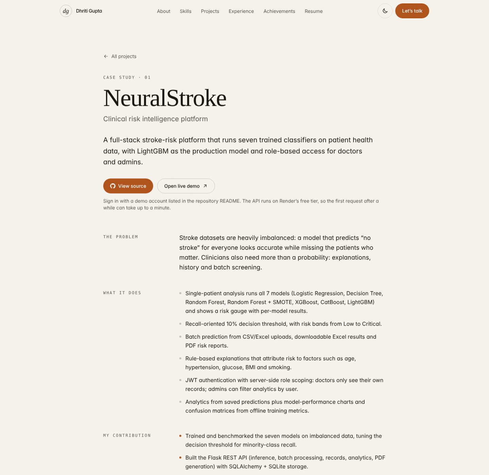

# Dhriti Gupta — Full-Stack MERN & AI/ML Portfolio

[](https://dhriti-portfolio-one.vercel.app/)
[](https://dhriti-portfolio-api.onrender.com/api/health)
[](https://github.com/dhriti-gupta-06/Dhriti-Portfolio)
[](https://nodejs.org/)
[](https://react.dev/)
[](https://www.mongodb.com/atlas)

The official personal portfolio of **Dhriti Gupta**, a Computer Science & Engineering undergraduate at JK Lakshmipat University (Visiting Student at IIT Kanpur, Jan–May 2026; Data Science Intern at Veracitiz) specializing in full-stack web engineering, scalable REST APIs, and applied AI/ML systems.

Built as an end-to-end **MERN** application:
- **Client:** Modern, ultra-responsive **React 19 + Vite + Tailwind CSS 4 + Framer Motion** single-page application deployed on **Vercel**.
- **Server:** Production-ready **Node.js + Express 5** REST API hosted on **Render**, featuring input sanitization, rate-limiting, security headers via Helmet, and resume streaming.
- **Database:** Cloud-hosted **MongoDB Atlas** storing verified contact submissions through **Mongoose 9** schemas.

---

## 🔗 Quick Links

| Resource | URL |
| --- | --- |
| 🌐 **Live Website** | [https://dhriti-portfolio-one.vercel.app/](https://dhriti-portfolio-one.vercel.app/) |
| ⚡ **Backend API Health** | [https://dhriti-portfolio-api.onrender.com/api/health](https://dhriti-portfolio-api.onrender.com/api/health) |
| 🐙 **GitHub Repository** | [https://github.com/dhriti-gupta-06/Dhriti-Portfolio](https://github.com/dhriti-gupta-06/Dhriti-Portfolio) |
| 📄 **PDF Resume (API Endpoint)** | [https://dhriti-portfolio-api.onrender.com/api/resume/pdf](https://dhriti-portfolio-api.onrender.com/api/resume/pdf) |
| 📝 **Word Resume (API Endpoint)** | [https://dhriti-portfolio-api.onrender.com/api/resume/docx](https://dhriti-portfolio-api.onrender.com/api/resume/docx) |

---

## 📸 Visual Showcase

| Dark Theme | Light Theme |
| :---: | :---: |
|  |  |

| Mobile Responsive View | Contact Submission (Persisted in MongoDB) |
| :---: | :---: |
|  |  |

| Case Study View (`/projects/:slug`) |
| :---: |
|  |

---

## ✨ Features

### Frontend (React + Vite + Tailwind CSS)
- **Dynamic Hero Section:** Animated typewriter rotating roles (*Aspiring Software Engineer*, *Full-Stack Developer*, *AI/ML Enthusiast*, *Cloud Computing Enthusiast*), scroll-triggered reveal animations, and direct **Download CV** and **Explore Projects** CTAs.
- **Comprehensive About Section:** Academic background (JK Lakshmipat University, Visiting Student at IIT Kanpur), quick facts, CGPA, and current status.
- **Categorized Skills Matrix:** Visualized across 6 distinct categories with animated proficiency bars and accessible hover/focus tooltips.
- **Interactive Project Showcase:** Real-time multi-category filtering (*All*, *Machine Learning*, *AI / LLM*, *Full-Stack*, *Frontend*), live demo links, repository buttons, tech stack tags, and deep-dive case study routes at `/projects/:slug`.
- **Vertical Timeline:** Chronological timeline distinguishing education and industry internships with custom icons and milestone markers.
- **Dual-Format Resume Downloads:** Direct streams for **PDF** and **Word (.docx)** resumes served by the Express backend.
- **Accessible Contact Form:** Client-side validation, debounce protection, double-submit guard, animated loading states, and instant success confirmation once persisted in MongoDB.
- **Theme Engine:** Dark and light modes with system preference auto-detection, manual toggle, and zero flash on initial load (`localStorage` backed).
- **Accessibility & SEO:** WCAG compliant with semantic landmarks, keyboard navigation, visible focus indicators, `prefers-reduced-motion` compliance, and meta tags.

### Backend (Node.js + Express + MongoDB Atlas)
- **`POST /api/contact`:** Strict field validation and HTML sanitization, Mongoose schema enforcement, anti-spam rate limiting, and private logging that excludes personal message contents.
- **`GET /api/resume/pdf` & `GET /api/resume/docx`:** Streams real resume files with proper MIME types and `Content-Disposition: attachment` headers.
- **`GET /api/health`:** Real-time health check reporting service uptime, timestamp, and active MongoDB connection status.
- **Production Hardening:** Helmet HTTP security headers, CORS origin whitelisting (`CLIENT_URL`), 10 KB request body limit, global error handling, and graceful shutdown handlers.

---

## 🛠️ Tech Stack

| Layer | Technologies |
| --- | --- |
| **Frontend** | React 19, React Router 7, Vite 8, Tailwind CSS 4, Framer Motion |
| **Backend** | Node.js 20+ (LTS), Express 5, Mongoose 9, Helmet, express-rate-limit, validator, cors |
| **Database** | MongoDB Atlas (Cloud M0 Cluster) |
| **Testing** | Node test runner (`node:test`) + Supertest (API), Vitest (Client logic), Playwright |
| **Hosting & CI/CD** | Vercel (Frontend SPA), Render (Backend Web Service), MongoDB Atlas (Database) |

---

## 🏛️ System Architecture

```text
                        ┌──────────────────────────────────────────────┐
                        │              Client (Vercel)                 │
                        │     https://dhriti-portfolio-one.vercel.app  │
                        └──────────────────────┬───────────────────────┘
                                               │
                                  HTTPS Requests (REST API)
                                               │
                                               ▼
                        ┌──────────────────────────────────────────────┐
                        │             Server (Render)                  │
                        │    https://dhriti-portfolio-api.onrender.com │
                        └──────────────┬────────────────┬──────────────┘
                                       │                │
                      Streams Resumes  │                │ Mongoose ODM
                      (PDF / DOCX)     ▼                ▼
                           ┌─────────────────┐   ┌──────────────────────┐
                           │ server/resumes/ │   │    MongoDB Atlas     │
                           │   Static Files  │   │   contacts cluster   │
                           └─────────────────┘   └──────────────────────┘
```

- **In Local Development:** Vite dev server proxies `/api/*` requests directly to `http://localhost:5000`, eliminating CORS friction.
- **In Production:** The React client targets the deployed Render URL specified in `VITE_API_BASE_URL`.

---

## 📂 Project Structure

```text
dhriti-portfolio/
├── client/                          # Frontend Application (React + Vite)
│   ├── public/                      # Static assets, favicon, photos
│   ├── src/
│   │   ├── components/              # Reusable UI (Navbar, Footer, ProjectCard, SkillBar, ThemeToggle...)
│   │   ├── context/                 # ThemeContext (Dark/Light state)
│   │   ├── data/                    # Single source of truth (profile, projects, skills, timeline)
│   │   ├── hooks/                   # Custom React hooks (useTypewriter, useActiveSection)
│   │   ├── pages/                   # Home, ProjectPage (/projects/:slug), NotFound (404)
│   │   ├── sections/                # Page sections (Hero, About, Skills, Projects, Contact...)
│   │   ├── services/api.js          # API client for contact submissions and resume downloads
│   │   └── utils/                   # Client-side validation logic
│   ├── vercel.json                  # SPA routing configuration for Vercel
│   ├── vite.config.js               # Vite bundler & Tailwind configuration
│   └── package.json
├── server/                          # Backend REST API (Node.js + Express)
│   ├── config/                      # Environment variables & MongoDB connection
│   ├── controllers/                 # Request handlers (contact, resume, health)
│   ├── middleware/                  # Rate limiting, validation, error handler
│   ├── models/Contact.js            # Mongoose Contact model schema
│   ├── resumes/                     # Dhriti_Gupta_Resume.pdf & .docx
│   ├── routes/index.js              # API route definitions
│   ├── tests/                       # Unit and integration test suite
│   ├── app.js                       # Express application configuration
│   ├── server.js                    # Server bootstrap & graceful shutdown
│   └── package.json
├── docs/                            # Screenshots & requirements audit
├── render.yaml                      # Render Blueprint deployment definition
└── package.json                     # Monorepo root scripts
```

---

## 🚀 Featured Projects Highlighted in Portfolio

1. **[NeuralStroke](https://stroke-prediction-system.vercel.app)** — Clinical Risk Intelligence Platform
   - Stack: Python, LightGBM, XGBoost, CatBoost, Flask, SQLAlchemy, React, Tailwind CSS
   - Benchmark of 7 classification models with a recall-oriented 10% threshold, CSV batch screening, and PDF report export.
   - [GitHub Repository](https://github.com/dhriti-gupta-06/Stroke-Prediction-System)

2. **[SalesCast AI](https://sales-forecast-by-prophet-model.vercel.app)** — Prophet Sales Forecasting System
   - Stack: Python, Facebook Prophet, pandas, Flask, SQLite WAL, React, Recharts
   - Automated group-wise forecasts across 500 product/outlet combinations with confidence intervals and SQL-driven analytics.
   - [GitHub Repository](https://github.com/dhriti-gupta-06/Sales-Forecast-By-Prophet-Model)

3. **[FloatChat](https://float-chat-coral.vercel.app)** — Conversational Ocean-Data Explorer
   - Stack: Next.js 14, TypeScript, Three.js, React Three Fiber, Plotly, Leaflet
   - Visualizes ARGO ocean sensor float profiles in 3D globe coordinates accompanied by conversational inquiry.
   - [GitHub Repository](https://github.com/dhriti-gupta-06/FloatChat)

4. **[DocuMind](https://github.com/dhriti-gupta-06/Document-Chat-Rag)** — Retrieval-Augmented Document Assistant
   - Stack: Python, LangChain, ChromaDB, HuggingFace, Streamlit
   - High-precision Q&A over local documents using RAG vector similarity and local language models.

5. **[TaskFlow](https://dhriti-gupta-06.github.io/TO-DO-App/)** — Responsive Task Management
   - Stack: JavaScript, HTML5, CSS3, LocalStorage
   - Filterable task tracking with local persistence and accessible UI interactions.

---

## 💻 Local Development Setup

### Prerequisites
- **Node.js**: v20 or higher (v22 LTS recommended)
- **npm**: v10 or higher
- **MongoDB**: A free MongoDB Atlas cluster URI or local MongoDB instance
- **Git**

### Installation

1. **Clone the repository:**
   ```bash
   git clone https://github.com/dhriti-gupta-06/Dhriti-Portfolio.git
   cd Dhriti-Portfolio
   ```

2. **Install all dependencies (Root, Server, and Client):**
   ```bash
   npm run install:all
   ```

3. **Configure Server Environment:**
   ```powershell
   # Windows PowerShell
   Copy-Item server\.env.example server\.env
   ```
   ```bash
   # macOS / Linux
   cp server/.env.example server/.env
   ```
   Open `server/.env` and insert your MongoDB connection string:
   ```env
   PORT=5000
   NODE_ENV=development
   MONGODB_URI=mongodb+srv://<username>:<password>@<cluster>.mongodb.net/portfolio?retryWrites=true&w=majority
   CLIENT_URL=http://localhost:5173
   ```

4. **Start Development Servers:**
   ```bash
   npm run dev
   ```
   - **Frontend:** [http://localhost:5173](http://localhost:5173)
   - **Backend API:** [http://localhost:5000](http://localhost:5000)
   - **Health Check:** [http://localhost:5000/api/health](http://localhost:5000/api/health)

---

## ⚙️ Environment Variables

### Server (`server/.env`)

| Variable | Description | Example / Production Value |
| --- | --- | --- |
| `PORT` | Port the Express server listens on | `5000` |
| `NODE_ENV` | Runtime environment | `development` or `production` |
| `MONGODB_URI` | MongoDB Atlas connection string (**Secret**) | `mongodb+srv://.../portfolio?retryWrites=true&w=majority` |
| `CLIENT_URL` | Allowed frontend origin for CORS | `https://dhriti-portfolio-one.vercel.app` |
| `CONTACT_RATE_LIMIT_MAX` | Max submissions per window per IP | `5` |
| `CONTACT_RATE_LIMIT_WINDOW_MS` | Rate-limit window duration (ms) | `900000` (15 minutes) |

### Client (`client/.env.local` / Vercel Environment)

| Variable | Description | Example / Production Value |
| --- | --- | --- |
| `VITE_API_BASE_URL` | Base URL for the deployed Express API | `https://dhriti-portfolio-api.onrender.com` |

*(Note: In local development, leave `VITE_API_BASE_URL` empty to utilize the built-in Vite proxy).*

---

## 📡 API Reference

Base Production URL: `https://dhriti-portfolio-api.onrender.com`

### 1. Health & Liveness
- **Endpoint:** `GET /api/health`
- **Description:** Verifies service uptime and active database connectivity.
- **Example Request:**
  ```bash
  curl -X GET https://dhriti-portfolio-api.onrender.com/api/health
  ```
- **Example Response:**
  ```json
  {
    "status": "ok",
    "database": "connected",
    "uptimeSeconds": 128,
    "timestamp": "2026-10-20T05:40:00.000Z"
  }
  ```

### 2. Contact Message Submission
- **Endpoint:** `POST /api/contact`
- **Headers:** `Content-Type: application/json`
- **Body Schema:**
  ```json
  {
    "name": "Alex Johnson",
    "email": "alex.johnson@example.com",
    "message": "Hi Dhriti, I saw your portfolio and would like to discuss an opportunity."
  }
  ```
- **Validation Rules:**
  - `name`: Required string, 2–80 characters.
  - `email`: Required valid email address, ≤ 254 characters (normalized to lowercase).
  - `message`: Required string, 10–2,000 characters.
- **Responses:**
  - `201 Created`: Message persisted in MongoDB Atlas.
  - `400 Bad Request`: Validation failure.
  - `429 Too Many Requests`: IP rate-limit reached (5 submissions / 15 min).
  - `503 Service Unavailable`: MongoDB Atlas connectivity failure.

### 3. Resume File Downloads
- **Endpoints:**
  - `GET /api/resume/pdf` — Streams `Dhriti_Gupta_Resume.pdf`
  - `GET /api/resume/docx` — Streams `Dhriti_Gupta_Resume.docx`
- **Headers Sent:** `Content-Disposition: attachment; filename="Dhriti_Gupta_Resume.<ext>"`

---

## 🧪 Testing & Quality Assurance

Run all test suites across the monorepo:

```bash
# Run both server and client test suites
npm test

# Run API tests only (node:test + Supertest)
npm test --prefix server

# Run client tests only (Vitest)
npm test --prefix client
```

### Coverage Overview:
- **Server Tests (20 tests):** Health check, resume streaming (PDF/DOCX), 404 on missing assets, CORS policy enforcement, payload size limits (10 KB), rate limiting, NoSQL injection sanitization, and DB failover.
- **Client Tests (6 tests):** Input validation schemas, project dataset integrity, GitHub URL accessibility, and slug uniqueness.

---

## 🚢 Deployment Details

### 1. Backend on Render
- **Blueprint File:** [`render.yaml`](file:///d:/dhriti-portfolio/render.yaml)
- **Root Directory:** `server`
- **Build Command:** `npm ci --omit=dev`
- **Start Command:** `npm start`
- **Health Check Path:** `/api/health`
- **Live Endpoint:** `https://dhriti-portfolio-api.onrender.com`

### 2. Frontend on Vercel
- **Root Directory:** `client`
- **Framework Preset:** `Vite`
- **Routing Rules:** Configured in [`client/vercel.json`](file:///d:/dhriti-portfolio/client/vercel.json) to support client-side React Router rewrites.
- **Environment Variable:** `VITE_API_BASE_URL=https://dhriti-portfolio-api.onrender.com`
- **Live Site:** `https://dhriti-portfolio-one.vercel.app/`

---

## 👤 Author

**Dhriti Gupta**  
- **Portfolio:** [dhriti-portfolio-one.vercel.app](https://dhriti-portfolio-one.vercel.app/)  
- **GitHub:** [@dhriti-gupta-06](https://github.com/dhriti-gupta-06)  
- **LinkedIn:** [dhriti-gupta-557101314](https://www.linkedin.com/in/dhriti-gupta-557101314/)  
- **Email:** [dhritigupta2411@gmail.com](mailto:dhritigupta2411@gmail.com)

---

## 📄 License

This project is licensed under the [MIT License](LICENSE).
